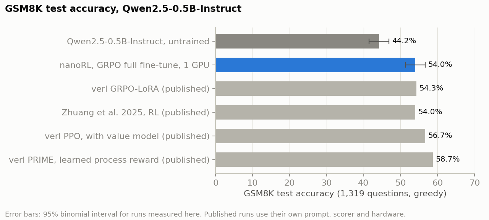
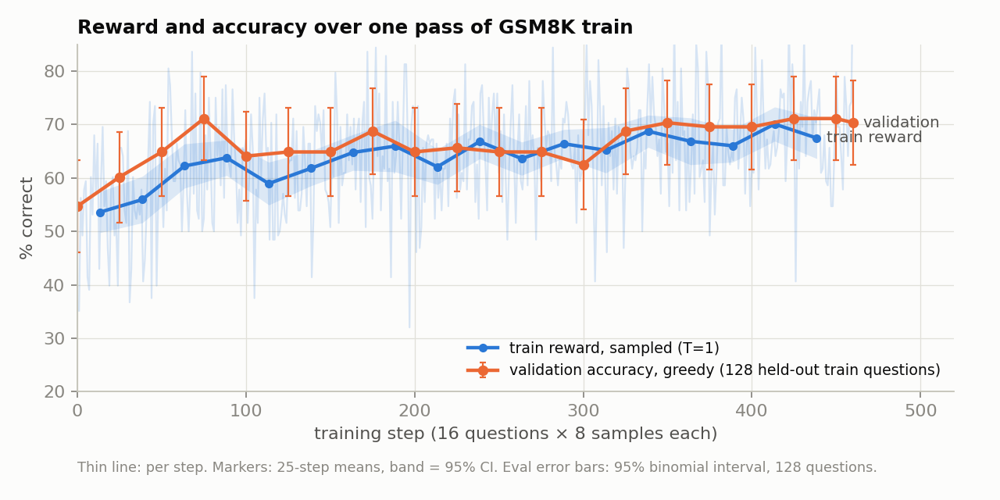
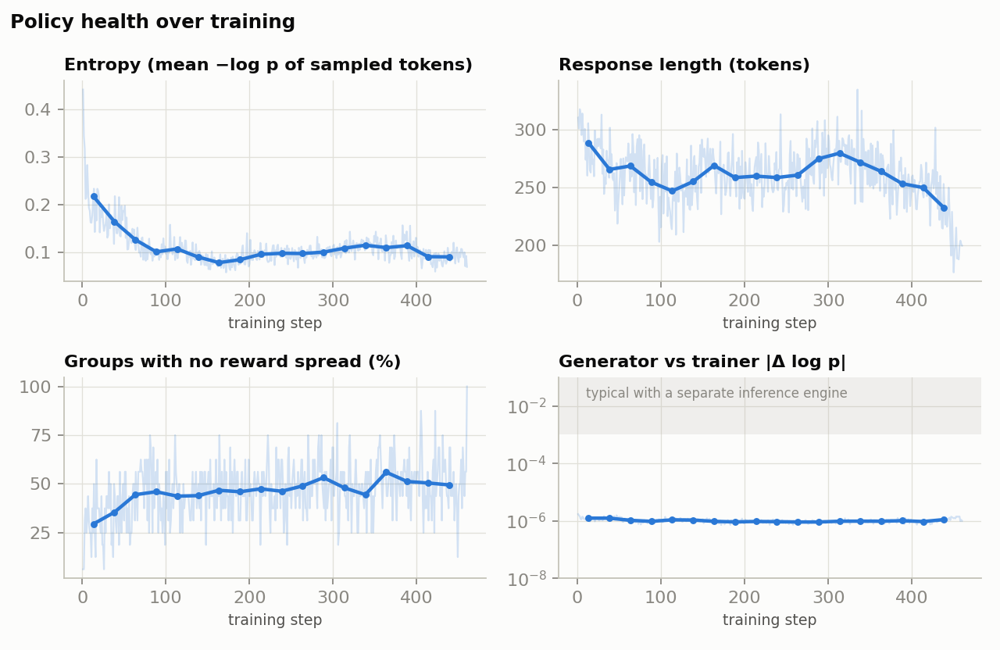
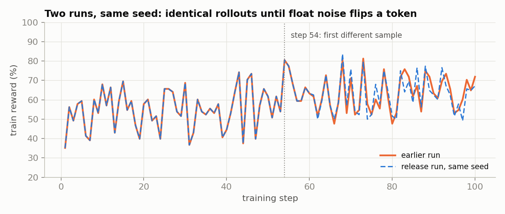

# nanoRL

The overarching goal of this repo is to keep it readable - forever (at least one can hope so)

So here it is - A small reinforcement-learning post-training stack one can read in an afternoon: it's about 1400 lines of code (at least today) that allows for a full fine-tuning on a single GPU. Through and through, I have tried to keep it modular where you could swap out any part of the stack, be it the generator, or the policies - still needs some work in that direction. The trainer, for instance, only ever sees the trajectories (tokens, log-probs,
rewards), thus the generator that produces them is a simple plug-in right now. A Hugging Face decode loop by default,
which could be swapped out with say SGLang using the same two-method interface.

*Environments need a cleaner interface. Today, a task is a module with prompts and a score(task, text) function, which covers single-turn tasks. Multi-turn and external environments need a proper rollout loop support.*

For the single-GPU run, the most feasible model for a full model RL was the `Qwen2.5-0.5B-Instruct` on GSM8K.

I know this has been tried, tested, and tired but I had to start somewhere. Here are some Results.

**Result:** Qwen2.5-0.5B-Instruct on GSM8K goes from **44.2% to 54.0%** on the full test set (1,319
questions, greedy) after one pass over the training set: 460 steps, **13.3 hours on one RTX 4060 Ti
(16 GB)**, with full fine-tuning in fp32. This aligns with other published RL results for this model.



| Model | GSM8K test | |
|---|---|---|
| Qwen2.5-0.5B-Instruct, untrained | 44.2% | |
| **nanoRL, GRPO full fine-tune** | **54.0%** | +9.8 pts (95% CI +7.0 to +12.5), 243 questions gained, 114 lost |
| verl GRPO-LoRA ([published](https://verl.readthedocs.io/en/latest/algo/baseline.html)) | 54.3% | |
| Zhuang et al. 2025, RL ([arXiv 2506.13404](https://arxiv.org/abs/2506.13404)) | 54.0% | |
| verl PPO, with a value model (published) | 56.7% | |
| verl PRIME, with a learned process reward (published) | 58.7% | |

Training run: [wandb](https://wandb.ai/scratchpad/nanoRL-release/runs/jgysiql7).

## What it does

Each training step:

1. **Generate.** 16 GSM8K questions × 8 samples each at temperature 1, up to 512 new tokens. All 128 rows
   decode together (left-padded, KV-cached) with the trainer's own fp32 model.
2. **Score.** Reward 1 if the number after the final `####` (or inside `\boxed{}`) equals the answer, else 0.
3. **Advantage.** GRPO: each sample's reward minus its group's mean, divided by the group's std.
4. **Update.** PPO-clipped policy loss (ε = 0.2) against a frozen *proximal* copy of the policy's
   log-probs, with a decoupled correction weight for any gap between the generator's and the trainer's
   log-probs. Token-mean loss, AdamW at lr 1e-6, gradient clipping at 1.0, no KL penalty, no reference
   model. One optimizer step per batch by default (`update_epochs × num_minibatches` is configurable).
5. **Evaluate and checkpoint** every 25 steps: greedy accuracy on 128 questions held out from GSM8K's
   train split. Checkpoints keep the best and the latest two, with optimizer state, so a run resumes
   exactly where it stopped.





What these mean -
- **Train reward vs. validation.** Train reward is the mean of 128 sampled (T=1) rewards - pass@1 on that step's 16 questions x 8 rollouts. Validation is greedy accuracy on 128 questions held out from GSM8K's train split.
- **Entropy** (mean −log p of the sampled tokens, an unbiased estimate of per-token entropy at T=1) halves
  in the first 100 steps and then holds. This looks expected as shown in
  ([Cui et al. 2025](https://arxiv.org/abs/2505.22617).
- **Groups with no reward spread** (all 8 samples right, or all wrong) rise from a third to half of each
  batch. These groups have zero advantage and contribute no gradient - that's why it seems like it would be a good bet to bring
  ([DAPO](https://arxiv.org/abs/2503.14476) next - it adds dynamic sampling for exactly this.
- **Generator vs trainer log-prob gap** stays at ~1e-6: same weights, fp32. I would have been suspicious if this was any higher given that we are using fp32 with PyTorch, no CUDA graphs, and no fancy kernels in the pipeline.

The curve shapes and magnitudes also match verl's public PPO log for the same model
([log](https://github.com/eric-haibin-lin/verl-data/blob/experiments/gsm8k/Qwen2.5-0.5B-bsz256_2-prompt1024-resp512-0.567.log))



This is just a same-seed replay to establish deterministic runs.


## Quickstart

```bash
pip install -r requirements.txt

python driver.py gsm8k                                   # train (about 13 h on a 16 GB GPU)
python driver.py gsm8k checkpoints/<run>/step-000100     # resume; reattaches to the same wandb run
python eval_test.py base=Qwen/Qwen2.5-0.5B-Instruct trained=checkpoints/<run>/step-000460
python -m pytest tests -q                                # 53 tests, CPU only, a few seconds
```

Set `WANDB_ENTITY` / `WANDB_PROJECT` to change where the logs go, or
`WANDB_MODE=offline` to keep everything local.


## Bring your own generator

Anything with these three methods can produce rollouts:

```python
class MyGenerator:
    def __init__(self, model, eos_token_ids, pad_token_id): ...
    def generate(self, input_prompts, num_gens=1, max_samples_per_gen=8192, greedy=False):
        # input_prompts: unpadded 1-D token-id tensors. Return len(input_prompts) * num_gens rows,
        # prompt k owning rows k*num_gens .. (k+1)*num_gens - 1, each a dict with
        # response_ids, behavior_logprobs (log-prob of each sampled token) and finish_reason
        ...
    def sync(self, model):
        # called after every optimizer step: copy the trainer's new weights into the engine
        ...
```

Set `generator_cls = MyGenerator` in `driver.py`. The worker constructs it inside its own process, so
an engine like vLLM or SGLang starts on the worker's GPU. The default `HFGenerator` (`rollout.py`)
decodes with the trainer's own module, so its `sync` has nothing to do.
`tests/test_workers.py::test_any_generator_with_generate_and_sync_drives_the_worker` runs collection,
a training step and evaluation through a fake engine that implements only these methods.


## Code Notes for the Humans

| File | What it does |
|---|---|
| `driver.py` | The training loop: batches, steps, evals, checkpoints, wandb, resume. All settings. |
| `rollout.py` | Batched generation (`generate_rollouts`), the default `HFGenerator`, grouping and scoring. |
| `learner.py` | Proximal scoring and the training step (micro-batches, minibatches, update epochs). |
| `losses.py` | Token log-probs, group-normalized advantages, the clipped decoupled policy loss. |
| `batching.py` | Collates trajectory groups into padded tensors with loss masks. |
| `protocol.py` | `Trajectory` and `RolloutGroup`, the only things that cross from generator to trainer. |
| `workers.py` | Ray actors. `SyncWorker` (used here) generates and trains on one GPU; `RolloutWorker` and `LearnerWorker` split them for async training. |
| `buffer.py` | Bounded rollout buffer with a max policy lag, for the async path. |
| `tasks/` | Task modules: prompts, splits, scoring. `gsm8k`; `music` is **experimental** (the 0.5B model gets zero reward on it). |
| `eval_test.py` | Greedy test-set accuracy and paired comparisons between checkpoints. |
| `scripts/` | Development tools, run from the repo root as `python -m scripts.<name>`: `plot_run` (these figures), `kl_compare` and `eval_compare` (batched vs unbatched generation checks), `harness` and `rollout_test_harnes`. |
| `tests/` | 53 unit tests. |


## As for what's Next!

- Support for beyond GRPO. DAPO, Score-centering, and more.
- Speed up the generator. It's an abomination right now - so Static KV cache, CUDA graphs, low-bit (KL KL KL!)
- LoRA and asynchronous rollouts (`RolloutWorker` / `LearnerWorker` / `RolloutBuffer` are already here) - To squeeze a bigger model, LoRA is the likely resort.
- Generator–trainer KL tests as part of the test suite
- More realistic dataset - introduce tool use, multi-turn - things not from the previous decade.

## License

MIT. The vendored `mimo_music/` scorer keeps its Apache-2.0 license.
